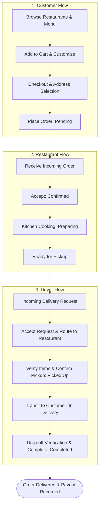

# Smart Food Delivery System (Mobile)

A multi-role food ordering, delivery logistics, and restaurant management platform built with **Flutter & Dart**. The application seamlessly coordinates **Customers**, **Restaurant Partners**, **Delivery Drivers**, and **Admins** within a unified design system and scalable mobile architecture.

Developed by **Team 5**, Department of Computer Science, **Royal University of Phnom Penh (RUPP)**.  
**Lecturer:** Mr. Chen Bunthoeurn

---

## 📌 System Flow & User Roles

The platform manages the complete lifecycle of a food delivery order across three primary mobile user roles:



### Order Status Lifecycle
All roles stay in sync through standardized status indicators:
`Pending` ➔ `Confirmed` ➔ `Preparing` ➔ `Ready for Pickup` ➔ `Picked Up` ➔ `In Delivery` ➔ `Completed` *(or `Cancelled` / `Rejected`)*

---

## 🏗️ Architecture & Project Structure

The project implements a **Feature-Driven Hybrid Architecture** separating core foundations, reusable design system components, and role-specific domains:

```
lib/
├── main.dart                            # Application entry point & theme initialization
│
├── core/                                # Universal foundations (Zero feature dependencies)
│   ├── constants/                       # Brand tokens, dimensions, typography, API endpoints
│   │   ├── app_colors.dart              # Primary (#5B21B6), Secondary (#2ECC71), neutral & status colors
│   │   ├── app_sizes.dart               # Spacing, button/card radii, and layout padding
│   │   ├── app_text_styles.dart         # Inter & Kantumruy text styles
│   │   └── api_endpoints.dart           # Base URLs, REST endpoints, and timeout configs
│   ├── theme/                           # Centralized Material 3 ThemeData
│   │   └── app_theme.dart               # Unified light theme configuration
│   ├── network/                         # Network & REST API abstraction layer
│   │   ├── api_client.dart              # REST client contract and header management
│   │   └── api_exceptions.dart          # Typed API exception models (401, 404, 500, offline)
│   ├── routes/                          # Centralized routing definitions
│   │   └── app_routes.dart              # Route constants for all roles
│   └── utils/                           # General-purpose helpers
│       ├── formatters.dart              # Currency ($ and KHR), date, and order ID formatters
│       └── validators.dart              # Form validation rules (email, phone, password)
│
├── shared/                              # Reusable Company-wide Design System Library
│   ├── shared_widgets.dart              # Single-line barrel export
│   └── widgets/
│       ├── buttons/                     # PrimaryButton, SecondaryButton, AppOutlineButton
│       ├── forms/                       # CustomTextField, PasswordTextField, SearchInputField, QuantitySelector
│       ├── badges/                      # StatusBadge with contextual colors per OrderStatus
│       ├── cards/                       # FoodCard, OrderCard
│       ├── navigation/                  # CustomAppBar with back action
│       └── feedback/                    # LoadingIndicator, EmptyStateView, CustomDialog
│
├── features/                            # Self-contained business domains by user role
│   ├── auth/                            # Login, registration, OTP, welcome screen
│   │   ├── models/                      # Auth data models
│   │   ├── repositories/                # Authentication API services
│   │   ├── screens/                     # WelcomeScreen, LoginScreen, RegisterScreen
│   │   └── widgets/                     # Auth-specific private widgets
│   ├── customer/                        # Customer mobile experience
│   │   ├── models/                      # Food, CartItem, CustomerOrder, Address
│   │   ├── repositories/                # Customer browse & checkout services
│   │   ├── screens/                     # Home, Cart, Checkout, Orders, Favorites, Profile
│   │   └── widgets/                     # Customer-specific private widgets
│   ├── driver/                          # Driver delivery workflow
│   │   ├── models/                      # DeliveryRequest, DriverEarnings
│   │   ├── repositories/                # Driver dispatch and trip services
│   │   ├── screens/                     # Dashboard, Requests, Active Delivery, Earnings, Profile
│   │   └── widgets/                     # Driver-specific private widgets
│   ├── restaurant/                      # Restaurant partner workflow
│   │   ├── models/                      # MenuItem, KitchenOrder
│   │   ├── repositories/                # Restaurant menu & order management services
│   │   ├── screens/                     # Dashboard, Live Orders, Menu Management, Profile
│   │   └── widgets/                     # Restaurant-specific private widgets
│   └── admin/                           # Platform administrative operations
│       ├── models/                      # Analytics & management models
│       ├── repositories/                # Admin services
│       ├── screens/                     # Platform oversight views
│       └── widgets/                     # Admin metric cards & tables
│
└── constants/, widgets/common/, screens/auth/  # Backward-compatibility barrel exports
```

---

## 🎨 Design System

| Token | Hex / Specification | Description |
|---|---|---|
| **Primary 700** | `#5B21B6` | Main brand color for CTAs, headers, and active states |
| **Primary 800** | `#491896` | Primary hover & pressed state |
| **Secondary 500** | `#2ECC71` | Accent color for success states, confirmations & highlights |
| **Secondary 600** | `#22A559` | Secondary hover & active state |
| **Typography** | `Inter` & `Kantumruy Pro` | Clear legibility in English and Khmer text |

Design tokens are centralized in `lib/core/constants/` and accessible across all widgets.

---

## 💻 Tech Stack

| Item | Details |
|---|---|
| **Framework** | Flutter 3.50.0 (stable) |
| **Language** | Dart 3.14.0 |
| **UI Components** | Material 3 & Custom Design System |
| **Fonts** | Inter / Poppins (English), Kantumruy Pro (Khmer) |
| **Backend** | REST API (separate repository) |

---

## 🚀 Getting Started

### Prerequisites
- **Flutter SDK:** `^3.50.0`
- **Android Studio:** Android SDK & NDK `28.2.13676358`
- Android Emulator or physical device with USB debugging enabled.

### Installation & Run

```bash
# 1. Clone repository
git clone <repository-url>
cd food_delivery

# 2. Install dependencies
flutter pub get

# 3. Check environment
flutter doctor

# 4. Run application
flutter run
```

> **Windows users:** Clone the project into a short path with no spaces or brackets (e.g., `D:\flutter_projects\food_delivery`). Paths containing characters like `RUPP(UNI)` may cause Gradle builds to fail.

---

## 🤝 Contributing Guidelines

1. **Branching Strategy:** Do not push directly to `main`. Create feature branches (`feature/<feature-name>`) and open pull requests into `develop`.
2. **Review Process:** The Team Lead reviews and approves pull requests before merging.
3. **Screen Convention:** Keep one screen per file named after the view (e.g., `order_details_screen.dart`).
4. **Design Tokens:** Never hardcode raw hex colors or magic spacing numbers in screens. Always reference `AppColors` and `AppSizes`.
5. **Shared vs Feature Widgets:** Place widgets used across 2+ roles in `lib/shared/widgets/`. Role-specific widgets belong in `lib/features/<role>/widgets/`.
6. **Security:** Never commit secrets, credentials, keystores, or `.env` files.
7. **Verification:** Always run `flutter analyze` and `flutter test` before opening a pull request.

---

## 👥 Development Team (Team 5)

- **Lim Ansoleaphea** — Team Lead
- **Sorn Noeng**
- **Vuth Sovathidapov**
- **Ly Mengleang**
- **Loeng Lin**
- **Chan Veasna**
- **Lem Senghor**
